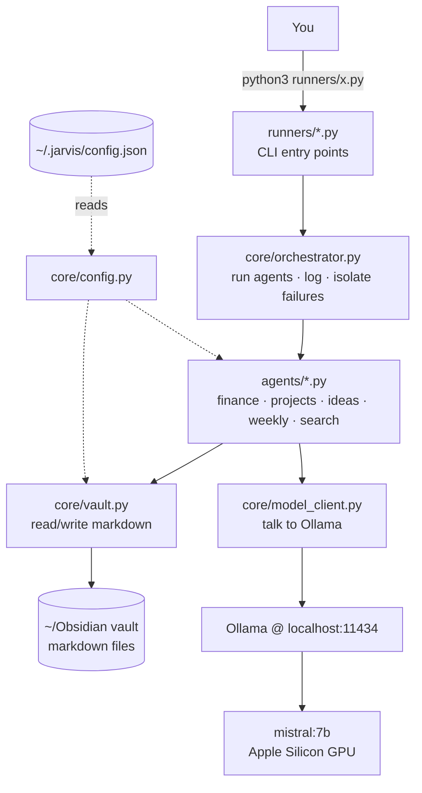

# Architecture

Jarvis is deliberately small. The whole system is four layers, each with one
job, connected by plain function calls and plain markdown files. There is no
message bus, no database, and no network beyond `localhost`.

## The big picture



Text version (for terminals):

```
runners/*.py ─► core/orchestrator.py ─► agents/*.py ─┬─► core/vault.py ─► ~/Obsidian
                                                      └─► core/model_client.py ─► localhost:11434 ─► mistral:7b
core/config.py  ◄── ~/.jarvis/config.json   (single source of user settings)
```

## Why each component exists

### `core/config.py` — single source of user settings
Everything personalizable (vault path, your name, folder list) is read here
and nowhere else. This is what makes Jarvis forkable: a new user edits
`~/.jarvis/config.json`, never the source. Defaults are generic so a fresh
clone runs out of the box.

### `core/model_client.py` — the only thing that talks to the model
A minimal wrapper over Ollama's local HTTP API, built on `urllib` from the
standard library (zero dependencies). It is the **single choke point** for all
reasoning, which guarantees two invariants:
- **No cloud, ever** — the client only knows `localhost:11434`.
- **Self-healing** — if Ollama isn't running, `asegurar_servidor()` starts it
  (`brew services start ollama`, then `ollama serve`), and if it still can't,
  it raises `OllamaNoDisponible` so callers can degrade gracefully.

It supports both blocking generation and streaming (a generator that yields
tokens as they arrive).

### `core/vault.py` — the storage layer
Reads and writes the markdown files in your Obsidian vault directly on disk —
Obsidian doesn't need to be running. It handles listing notes, reading with a
size cap (so a huge note can't blow the model's context window), finding
recently-modified notes, writing analysis back, and bundling several notes
into one bounded prompt block (`resumen_corpus`).

### `core/orchestrator.py` — coordination and safety
Runs agents by name, times them, logs to `~/.jarvis/logs/jarvis.log`, and —
critically — wraps each agent in a `try/except` so **one failing agent never
takes down the weekly briefing**. It returns `(ok, markdown)` tuples.

### `agents/*.py` — the actual intelligence
Each agent is a plain module exposing one function:

```python
def run(**kwargs) -> str:   # returns markdown
    ...
```

That uniform contract is the whole "protocol." An agent typically:
1. Pulls relevant notes via `core.vault`.
2. Builds a prompt and calls `core.model_client`.
3. Returns markdown (and sometimes writes a note back to the vault).

`document_finder` is the exception — it's pure Python keyword search with no
model call, so it's instant and works offline.

### `runners/*.py` — thin CLI shims
One file per command. They add the repo root to `sys.path`, call an agent or
the orchestrator, print the markdown, and set an exit code. No logic lives
here on purpose — runners are replaceable skins over the agents.

### `automation/*.sh` — scheduling
`install_scheduler.sh` writes a `launchd` plist that runs the weekly briefing
every Sunday at 20:00. `startup_ollama.sh` guarantees the model is up before
any scheduled run. `trigger.sh` is the entry point `launchd` actually calls.
`launchd` is used instead of `cron` because it survives reboots and sleep.

## The Jarvis tab (`runners/web.py`)

```
browser tab (web/index.html: voice, wake word, panels)
   └─► runners/web.py  (stdlib http.server, 127.0.0.1 only)
         └─► core/asistente.py  (intent → action)
               ├─► agents/pendientes.py ─► core/sources/{tareas,agenda,correo}.py
               ├─► orchestrator (finance · projects · ideas · weekly · search)
               └─► brain: core/openjarvis_bridge.py (if `jarvis serve` is up) or Ollama
```

Details and setup: [JARVIS_TAB.md](JARVIS_TAB.md).

## How agents communicate

They don't talk to each other directly. Coordination is through two shared,
inspectable media:

1. **The orchestrator** calls agents and collects their markdown. The weekly
   agent asks the orchestrator to run finance + projects + ideas, then
   summarizes their combined output.
2. **The vault** is the shared memory. An agent's output is a markdown file
   another agent (or you, or Obsidian) can read later. State is just files.

This "everything is a file" design means you can debug the system by reading
notes, and extend it without touching a schema.

## Data flow: the weekly briefing

```
weekly.run()
  └─ orchestrator.ejecutar_todos()
       ├─ finance.run()   ─► reads Finance/, calls Mistral, returns markdown
       ├─ projects.run()  ─► reads Projects/, calls Mistral, returns markdown
       └─ ideas.run()     ─► reads Ideas/, calls Mistral, returns markdown
  └─ collects vault activity of the last 7 days
  └─ asks Mistral for a 6-line executive summary
  └─ vault.escribir_nota("Weekly", "<date>-weekly-briefing", ...)
```

## Design principles

- **Local-first, always.** The model only ever runs on `localhost`. The only
  outbound connections are the opt-in personal sources (IMAP to your mail
  provider, your calendar's `.ics`), which fetch *your* data *to* your machine.
- **Zero dependencies.** Standard library only. This is a feature, not a limitation.
- **Fail soft.** A missing model or empty folder produces a helpful message, not a stack trace.
- **Files over state.** The vault is the database. Everything is inspectable markdown.
- **Forkable by config.** Personalization lives in `~/.jarvis/config.json`, never in code.

## Extensibility

Adding capability means adding one `agents/your_agent.py` with a `run()`
function and (optionally) one `runners/your_agent.py` to call it. Register it
in `orchestrator._cargar_agentes()` if you want it in the weekly briefing.
Full walkthrough: [examples/custom_agent_example.py](examples/custom_agent_example.py)
and [CONTRIBUTING.md](CONTRIBUTING.md).
